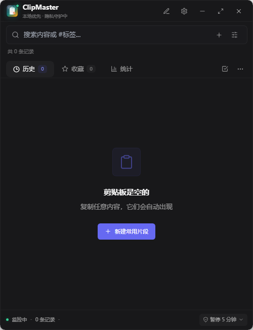

<p align="center">
  
</p>

<h1 align="center">ClipMaster</h1>

<p align="center">
  <strong>A local-first clipboard manager for Windows</strong>
</p>

<p align="center">
  Save, search, favorite, and manage clipboard history. Your data stays on your machine.
</p>

<p align="center">
  <a href="https://github.com/dhadb/ClipMaster/releases/latest"><strong>Download for Windows</strong></a>
  ·
  <a href="README.md">中文</a>
  ·
  <a href="PRIVACY.md">Privacy</a>
  ·
  <a href="SECURITY.md">Security</a>
</p>

<p align="center">
  
  
  
  
  
</p>

<p align="center">
  
</p>

## Overview

ClipMaster is a local-first clipboard manager for Windows. It continuously captures clipboard changes in the background and organizes text, links, code, colors, JSON, Markdown, and images into searchable, favoritable, batch-manageable history. All data stays on your machine and is encrypted at rest with Electron `safeStorage`.

## Highlights

- **Local-first**: Clipboard history, settings, and image cache are stored only under `%AppData%/ClipMaster/` — no upload, sync, or analytics.
- **Fast recovery**: Fuzzy, pinyin, tag, type, and workspace search finds copied text, links, code snippets, colors, JSON, Markdown, and images.
- **Privacy guardrails**: High-risk content such as passwords, tokens, private keys, and card numbers is skipped by default; per-app blocklists and timed monitoring pauses are supported.
- **Two focused workspaces**: Press `Ctrl + Shift + V` for compact Quick Paste, then switch to Library when you need full content, metadata, and management tools.
- **Efficient workflows**: Combine time, type, and sort filters, then batch favorite, pin, tag, or delete records.

## Quick Start

1. Open [Releases](https://github.com/dhadb/ClipMaster/releases/latest).
2. Download the `ClipMaster-Setup-<version>.exe` installer, or choose the portable `ClipMaster-Portable-<version>.exe`.
3. Run the installer, or launch the portable build directly.
4. Copy anything, press `Ctrl + Shift + V`, select an entry with the arrow keys, and press `Enter` to paste it back into the previous app.

## Verify the Installer

Release assets include `checksums.sha256`. After downloading the installer, verify it in PowerShell:

```powershell
Get-FileHash -Algorithm SHA256 ".\ClipMaster-Setup-<version>.exe"
```

Compare the SHA256 output with `checksums.sha256`. If it does not match, do not run the installer and report it in [Issues](https://github.com/dhadb/ClipMaster/issues).

Windows may show a SmartScreen warning for unsigned open-source installers. Download ClipMaster only from this repository's GitHub Releases.

## In-app Updates

ClipMaster supports in-app updates: when a new release is detected, the official Windows installer can be downloaded inside the app with live progress, and the release checksum is verified before installation. If the download fails, the Release page remains available as a fallback.

## Features

| Feature | Description |
| --- | --- |
| Live monitoring | Captures clipboard changes automatically |
| Multi-format clipboard | Preserves text, HTML, RTF, and Windows file lists; each saved file can be revealed in Explorer |
| History | Stores up to 5000 clipboard entries with a reusable search index and bounded query cache |
| Smart categories | Detects text, links, emails, code, colors, JSON, Markdown, images, file lists, and more |
| Command-style search | Fuzzy matches such as `git pu`, offline pinyin search, highlights, recent searches, saved filters, plus `#tags`, `type:`, `workspace:`, `app:`, `is:pinned`, `has:files`, and `has:rich` queries |
| Combined filters | Combine search and `#tags` with type, time range, newest/oldest/most-used sorting, and `type:` queries |
| Reusable snippets | Save frequently used text, commands, and replies manually |
| Tags | Organize any entry with tags preserved across import and export |
| Favorites and pins | Use pinning for immediate access; keep longer-lived replies, commands, and addresses in Favorites, then organize them with tags |
| Smart collections | Save a combined search, type, time, and sort view; result counts update as history changes |
| Workspaces | Automatically label captures by the foreground Windows app; add a manual workspace such as Project A, thesis, or travel in details |
| Two-mode workspace | Use compact Quick Paste for shortcut-driven paste flows and Library for navigation, inspection, and management |
| Batch actions | Pin, favorite, tag, or delete multiple selected records |
| Clipboard Stack | Queue multiple history items as a temporary paste list and copy them in order without persisting the queue |
| Content editing | Edit snippet content and tags in details with automatic type detection |
| Smart content actions | Open or clean tracking parameters from links, format or compact JSON, copy HEX/RGB colors, and normalize code line endings |
| Copy timeline | Review recent times an item was copied without duplicating it in the list |
| Delete undo | Restore recently deleted records before the notification expires |
| Stats | View type distribution and usage patterns |
| Personalized appearance | Eight themes, five independent accents, density, type size, opacity, and window size |
| Update checks | Check GitHub Releases at startup or manually, then download, install, and restart in the app |
| Data security | Encrypt local persistence with Electron `safeStorage` while migrating older plaintext data safely |
| Global shortcuts | Configure separate shortcuts for showing history, focusing search, and clearing unprotected records |
| Image performance | Store 256px JPEG thumbnails, bound renderer cache usage, and clean unreferenced image files |
| Import and export | Export text-only JSON metadata without images or local file-list records, then merge or replace history during import |
| Local privacy | No upload, sync, or clipboard analytics; block selected applications so their text, images, and file lists never enter history |
| Privacy controls | Toggle credential, payment-card, and identity-number detection separately; shows only how many items were skipped and supports timed, manual, or current-app monitoring pauses |

## Shortcuts

| Shortcut | Action | Scope |
| --- | --- | --- |
| `Ctrl + Shift + V` | Open the quick-paste panel | Global |
| `Ctrl + Shift + F` | Show window and focus search | Global |
| `Ctrl + Shift + Delete` | Clear unpinned, unfavorited records | Global |
| `Ctrl + F` | Focus search | In app |
| `Ctrl + N` | Create a reusable snippet | In app |
| `↑` / `↓` | Move selection | In app |
| `Enter` | Paste selected item back into the previous Windows app in Quick Paste; copy only in Library | In app |
| `Delete` | Delete selected item | In app |
| `Esc` | Clear search / close | In app |

## Privacy and Data Storage

ClipMaster contains no cloud services and never uploads, syncs, or analyzes your clipboard content. Default data directory:

```text
%AppData%/ClipMaster/
```

See [PRIVACY.md](PRIVACY.md) for details.

## Development

### Requirements

- Node.js 22.12+
- npm 10.9+
- Git
- Windows 10/11

### Run locally

```bash
git clone https://github.com/dhadb/ClipMaster.git
cd ClipMaster
npm install
npm run dev
```

### Common commands

| Command | Description |
| --- | --- |
| `npm run dev` | Start the dev server (renderer + Electron main process hot reload) |
| `npm run typecheck` | TypeScript type checking for renderer and main process |
| `npm test` | Run Vitest unit and component tests |
| `npm run test:coverage` | Run tests with a coverage report |
| `npm run lint` | Run ESLint over `src/` |
| `npm run check` | Combined gate: typecheck + tests + renderer build |
| `npm run build` | Typecheck + build + package the Windows installers into `release/` |

### Build the installer

```bash
npm run build
```

Build output goes to `release/`, containing the NSIS installer and the portable build.

## Roadmap

- [ ] Add Windows Authenticode code signing (certificate setup deferred)

## License

[MIT](LICENSE)
